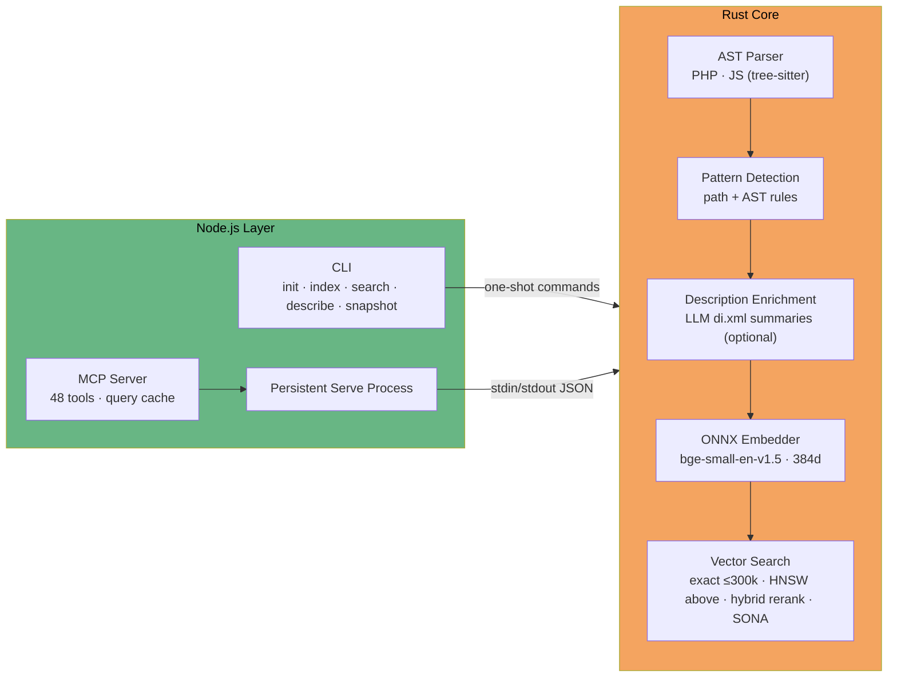
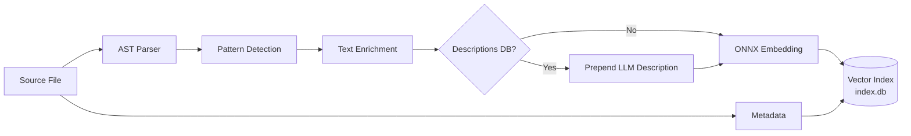
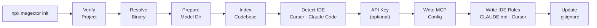
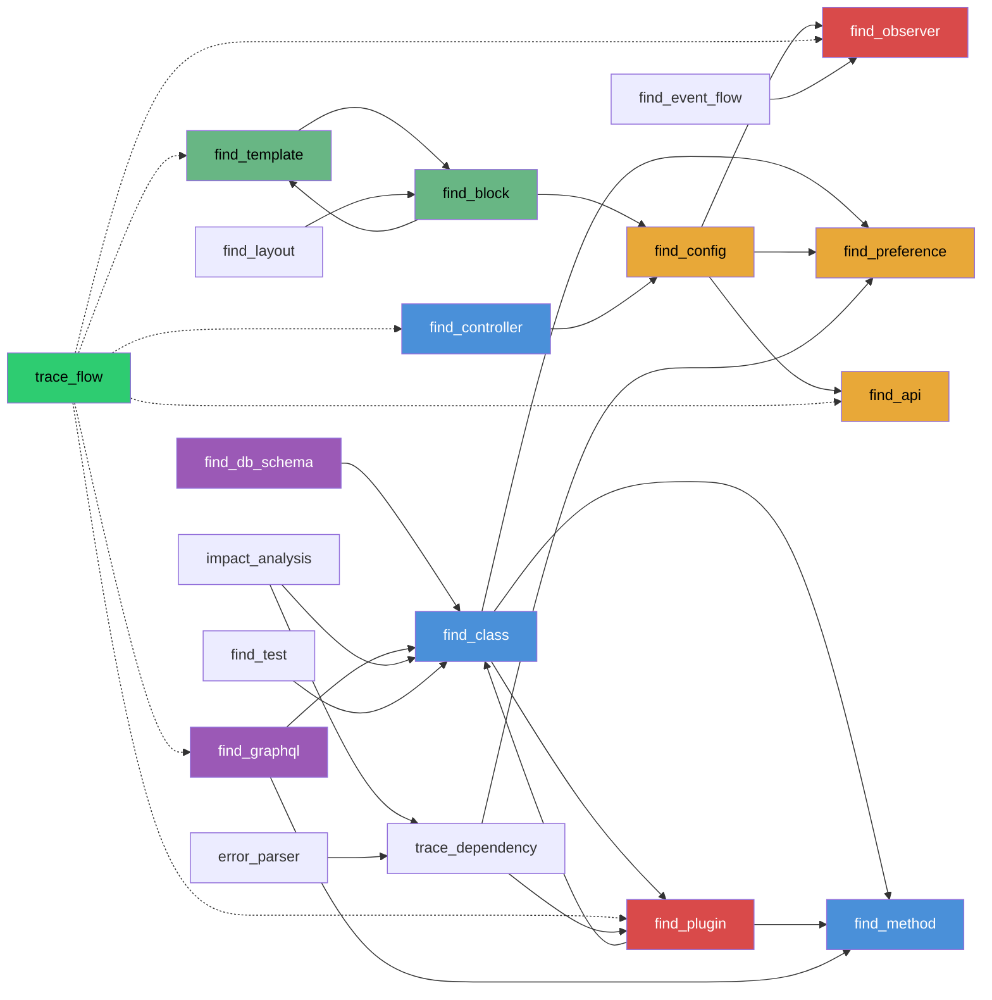
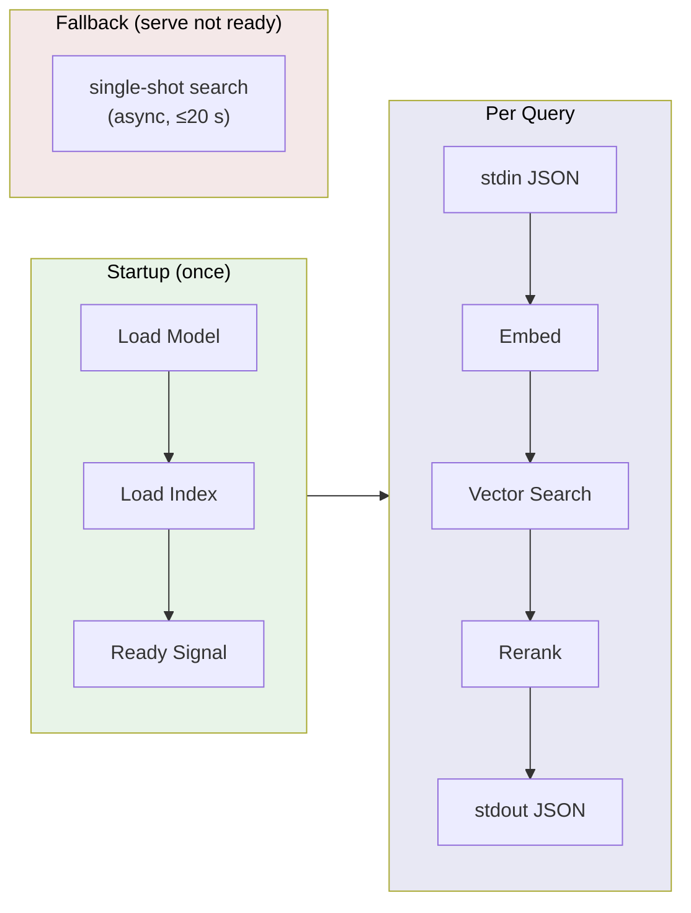
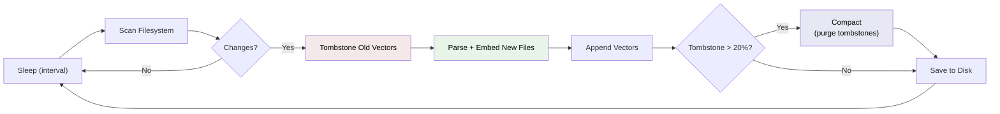
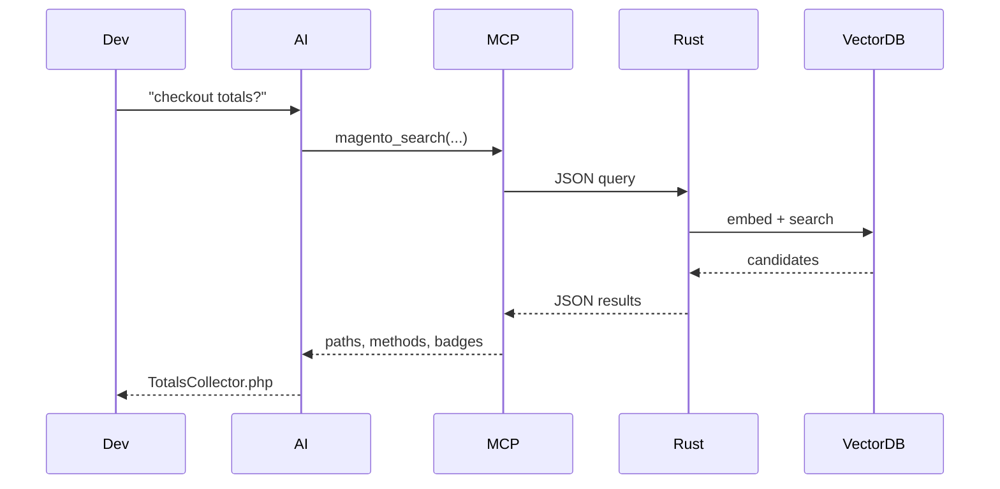
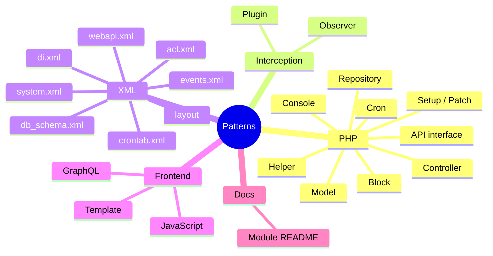

# Magector

**MCP server for Magento 2 and Adobe Commerce: a semantic index of the codebase plus structural tools that read the Magento configuration.**

Magector is a Model Context Protocol (MCP) server for Magento 2 and Adobe Commerce codebases. It builds a semantic vector index of the project's PHP, XML, JS, PHTML and GraphQL files (and the module READMEs under `app/code`) and exposes 48 tools that AI assistants use to search and navigate the code. A query such as *"how are checkout totals calculated?"* returns ranked files, each annotated with the Magento component type detected for it (plugin, observer, controller, block, layout XML and others). Structural tools answer questions such as "which plugins intercept this method" from `di.xml`, `events.xml`, `webapi.xml` and the other configuration files, without the vector index.

[](https://nodejs.org)
[](https://magento.com)
[](LICENSE)

---

## Why Magector

A Magento 2 or Adobe Commerce project consists of PHP, XML, JS, PHTML and GraphQL files spread across hundreds of modules. The codebase relies heavily on indirection: plugins intercept methods defined in other modules, observers react to events dispatched elsewhere, `di.xml` rewires interfaces to concrete classes, and layout XML stitches blocks and templates together.

Magector provides two kinds of answers:

1. **Semantic vector index** — every indexed file is embedded into a 384-dimensional space with the ONNX model bge-small-en-v1.5, and a query is matched to the nearest vectors (combined with keyword reranking), not to literal strings.

2. **Magento pattern detection** — the indexer classifies files by path and by their PHP AST (controllers, plugins, observers, blocks, models, repositories, GraphQL resolvers, cron, setup patches, API interfaces, configuration XML types and more). Every search result carries that classification.

The structural tools (DI, events, Web API, GraphQL, cron, DB schema and others) read the configuration files directly; see [How exact are the results?](#how-exact-are-the-results).

---

## Features

- **Semantic search** -- natural-language queries matched against embedding vectors of the indexed files
- **Hybrid search** -- combines semantic vector similarity with keyword re-ranking
- **Structured JSON output** -- semantic results include file path, class name, methods list, role badges and, for the top results, a content snippet
- **Persistent serve mode** -- a long-running `magector-core serve` process keeps the ONNX model and the vector index in memory, so a query does not load them
- **Incremental re-indexing** -- a background file watcher re-indexes changed files without a restart (tombstone + compact strategy)
- **ONNX embeddings** -- 384-dim embeddings with bge-small-en-v1.5 via ONNX Runtime (CPU)
- **Magento-aware** -- path- and AST-based detection of controllers, plugins, observers, blocks, resolvers, repositories and other Magento file types
- **Adobe Commerce** -- Adobe Commerce modules are indexed and parsed like Open Source modules (the verification runs in this repo used Magento Open Source and Mage-OS)
- **AST-based** -- tree-sitter parsing for PHP and JavaScript extracts classes, methods, namespaces and inheritance
- **Cross-tool hints** -- tool descriptions include keywords and "See also" references to related tools
- **SONA feedback learning** -- learns from MCP tool call sequences (e.g. search → find_plugin) and boosts matching result types for similar queries; an evaluation found no measurable ranking change. A rank-2 MicroLoRA adapter (1536 parameters) with EWC regularisation is present in the code but is not trained online (see [SONA Feedback Learning](#6-sona-feedback-learning))
- **Diff analysis** -- risk scoring and change classification for a git commit or the staged changes
- **Complexity analysis** -- cyclomatic complexity, function count and line count per file
- **LLM description enrichment** -- optional natural-language descriptions of di.xml files generated with Claude, stored in SQLite and prepended to the embedding text so they influence vector ranking
- **MCP server** -- 48 tools for Claude Code, Cursor and other MCP clients
- **Split architecture** -- the Rust core does indexing, embedding and vector search; the Node.js layer provides the CLI and the MCP server

---

## Architecture



### Indexing Pipeline



### Search Pipeline


### Components

| Component | Technology | Purpose |
|-----------|-----------|---------|
| Embeddings | `ort` (ONNX Runtime, CPU) | bge-small-en-v1.5, 384 dimensions |
| Vector search | exact cosine scan up to 300k vectors, `hnsw_rs` above + hybrid reranking | Nearest neighbors + keyword boosting |
| PHP parsing | `tree-sitter-php` | Class, method, namespace extraction |
| JS parsing | `tree-sitter-javascript` | AMD/ES6 module detection |
| Pattern detection | Custom Rust | Magento file types from path and AST |
| CLI | `clap` | Rust command-line interface (index, search, serve, describe, validate, download, stats, embed) |
| Metadata | rusqlite (bundled SQLite) | `.magector/data.db`: method-chain enrichment, process state, cache. `.magector/sqlite.db`: LLM descriptions of di.xml files |
| SONA | Custom Rust | Feedback learning from tool call sequences (pattern boosts; the MicroLoRA + EWC++ code path is not trained online) |
| MCP server | `@modelcontextprotocol/sdk` | AI tool integration |
| Config data | JSON exports in `.magector/config-data/` | One-time `core_config_data` exports per environment for config tracing |
| PHP scan snapshot | JSON in `.magector/php-scan.json` (0600) | Class hierarchy and event dispatch sites read once per root and shared by its MCP instances, checked by file stamps |

---

## Security

Magector operates on source code indexed from potentially untrusted `vendor/` dependencies and is driven by an LLM that may be manipulated via prompt injection in indexed comments, docblocks or markdown. The following hardening applies:

### Indexed markdown

The only markdown in the index is the project's own module READMEs, `app/code/<Vendor>/<Module>/README.md`: written next to that code and trusted like its comments. Markdown from `vendor/` packages and anywhere else is never indexed, so `magento_search` does not hand third-party markdown to the LLM. Code in `vendor/` is indexed, so its comments and docblocks are in the index and can appear in result snippets.

### Path arguments

Tools that read files under a `path` argument route it through the `safePath()` / `safeRelPath()` helpers in `src/mcp-server.js`:

- `safePath()`: `magento_read` (also inside `magento_batch`) and `magento_complexity`
- `safeRelPath()`: `magento_grep`, `magento_ast_search` and `magento_find_dataobject_issues` (also inside `magento_batch`), and `magento_validate_config`

These helpers:

1. Resolve the argument against `MAGENTO_ROOT` with `path.resolve()`, which normalizes `..`.
2. Reject any resolved path that does not lie inside `MAGENTO_ROOT`.

This stops a hostile `vendor/` comment from instructing the LLM to e.g. `magento_read` `../../home/user/.ssh/id_rsa`. The check is lexical: symlinks are not resolved, so a symlink inside `MAGENTO_ROOT` that points outside it passes the check and its target is read.

Other path-related rules:

- `magento_complexity` also rejects a `module` that is not of the form `Vendor_Module`.
- `magento_index` is not confined to `MAGENTO_ROOT`: its `path` is resolved against the server's working directory and must be an existing directory; anything else is refused. The index is written to the configured `MAGECTOR_DB`, replacing the current project's index.

The confinement only stops reads outside `MAGENTO_ROOT`. Everything inside it is readable by `magento_read` and `magento_grep`, including `app/etc/env.php` (database password, crypt key). Do not run the server against a root that holds production secrets.

### Git refs in `magento_analyze_diff`

`commitHash` must be a plain git ref: it starts with a letter or digit, contains only letters, digits and `_ . / ^ ~ -`, optionally ends in a reflog selector `@{n}`, and contains no `..`. Anything else is rejected. git runs without a shell, as `git -C $MAGENTO_ROOT …` with an argument array. An unknown ref, or a root that is not a git repository, returns git's error instead of an empty result.

### Auto-update

`src/update.js` reads the version of the `latest` dist-tag from `https://registry.npmjs.org/magector/latest` (cached for 1 h in `.magector/version-check.json` when the current directory has `.magector/`, else in `~/.magector/version-check.json`) and re-runs the CLI with that version when it is newer:

- A semver-strict `isSafeVersion()` validator rejects any version string that does not match `X.Y.Z` / `X.Y.Z-prerelease`.
- On POSIX the re-exec passes argv as an array with no shell.
- On Windows, where `npx` is a `.cmd` shim, the re-exec needs a shell; every argument is first checked against an allow-list, and the update is skipped (the current version runs) when an argument contains characters `cmd.exe` would interpret (spaces, `&`, `|`, quotes).
- Fails closed: when the version or an argument is rejected, the update is skipped.
- It never runs for `mcp` or `help`, and not when `MAGECTOR_NO_UPDATE` is set. The MCP config written by `init` starts the server as `npx -y magector@latest mcp`, so each MCP start can still fetch a newer version; pin `magector@<version>` in `.mcp.json` / `~/.cursor/mcp.json` to keep one version.

### Unix socket permissions

The serve-proxy Unix socket at `.magector/serve.sock` is set to mode `0600` right after `listen()`, so other local accounts cannot connect and query the index (which would leak indexed source snippets). If the chmod fails (e.g. on a platform without it), a warning is logged to `.magector/magector.log`.

### Reporting vulnerabilities

Report security issues privately through GitHub's private vulnerability reporting (the repository's Security tab → Report a vulnerability), not in a public issue. Do not include reproducers that leak source contents from private codebases.

---

## Quick Start

### Prerequisites

- [Node.js 20+](https://nodejs.org)

### 1. Initialize in Your Project

```bash
cd /path/to/your/magento2  # or Adobe Commerce project
npx magector init
```

This command handles the setup:



### 2. Search

```bash
npx magector search "product price calculation"
npx magector search "checkout totals collector" -l 20
```

### 3. Re-index After Changes

```bash
npx magector index
```

### 4. IDE Setup Only (Skip Indexing)

```bash
npx magector setup
```

### Manual MCP configuration

For another MCP client, or to write the config by hand, use the entry `init` writes (`.mcp.json` for Claude Code, `~/.cursor/mcp.json` for Cursor):

```json
{
  "mcpServers": {
    "magector": {
      "command": "npx",
      "args": ["-y", "magector@<version>", "mcp"],
      "env": {
        "MAGENTO_ROOT": "/path/to/magento",
        "MAGECTOR_DB": "/path/to/magento/.magector/index.db"
      }
    }
  }
}
```

`init` writes `magector@latest`; a pinned version is shown here. `init` adds `MAGECTOR_MODELS` (absolute) when it is set, and `ANTHROPIC_API_KEY` when you enter a key.

---

## CLI Reference

### Rust Core CLI

```
magector-core [-v|--verbose] <COMMAND>

Commands:
  index       Index a Magento codebase
  search      Search the index semantically
  serve       Start persistent server mode (stdin/stdout JSON protocol)
  describe    Generate LLM descriptions for di.xml files (requires an Anthropic API key)
  validate    Run the validation suite (downloads Magento if no root is given)
  download    Download Magento 2 Open Source
  stats       Show index statistics
  embed       Generate embedding for text
```

`-v, --verbose` is a global flag.

#### `index`

```bash
magector-core index -m <PATH> [OPTIONS]

Options:
  -m, --magento-root <PATH>          Path to Magento root directory (required)
  -d, --database <PATH>              Index database path [default: ./.magector/index.db]
  -c, --model-cache <PATH>           Model cache directory [default: ./models]
      --descriptions-db <PATH>       Path to descriptions SQLite DB (descriptions are prepended to embeddings)
      --threads <N>                  Max ONNX + rayon threads [default: half of CPU cores for ONNX; also MAGECTOR_THREADS]
      --batch-size <N>               Embedding batch size [default: 256; also MAGECTOR_BATCH_SIZE]
      --force                        Discard any existing index and rebuild (without it, indexing resumes)
```

When `--descriptions-db` is provided (or auto-detected as `sqlite.db` next to the index), descriptions are prepended to the embedding text as `"Description: {text}\n\n"` before the raw file content. This places the description within the 256 tokens the embedding model reads.

#### `search`

```bash
magector-core search <QUERY> [OPTIONS]

Options:
  -d, --database <PATH>      Index database path [default: ./.magector/index.db]
  -c, --model-cache <PATH>   Model cache directory [default: ./models]
  -l, --limit <N>            Number of results [default: 10]
  -f, --format <FORMAT>      Output format: text, json [default: text]
```

#### `describe`

```bash
magector-core describe -m <PATH> [OPTIONS]

Options:
  -m, --magento-root <PATH>   Path to Magento root directory (required)
  -o, --output <PATH>         Output SQLite database [default: ./.magector/sqlite.db]
      --api-key <KEY>         Anthropic API key [default: $ANTHROPIC_API_KEY]
      --model <MODEL>         Model [default: claude-sonnet-4-5-20250929]
      --force                 Re-describe all files (ignore cache)
```

Generates natural-language descriptions of di.xml files using the Anthropic API. Descriptions are stored in a SQLite database and used during indexing to enrich embeddings. Only files with changed content hashes are re-described (incremental by default).

#### `serve`

```bash
magector-core serve [OPTIONS]

Options:
  -d, --database <PATH>            Index database path [default: ./.magector/index.db]
  -c, --model-cache <PATH>         Model cache directory [default: ./models]
  -m, --magento-root <PATH>        Magento root (enables file watcher)
      --descriptions-db <PATH>     Path to descriptions SQLite DB
      --watch-interval <SECS>      File watcher poll interval [default: 60]
      --threads <N>                Max ONNX threads [default: half of CPU cores]
```

Starts a persistent process that reads JSON requests from stdin and writes JSON responses to stdout. It keeps the ONNX model and the vector index in memory for repeated queries.

When `--magento-root` is provided, a background file watcher polls for changed files every `--watch-interval` seconds and re-indexes them without a restart. The MCP server starts serve with `--watch-interval` set to `MAGECTOR_WATCH_INTERVAL` (default 300 s). Vectors of modified and deleted files are soft-deleted (tombstoned); new vectors are appended. When more than 20% of the vectors are tombstoned, they are purged (and the HNSW graph, used only above 300k vectors, is rebuilt).

**Protocol (one JSON object per line):**

On start, serve prints a ready line: `{"ok":true,"ready":true,"vectors":N,"watcher":true|false}`. Every reply is one JSON object; errors are `{"ok":false,"error":"..."}`. A request may carry an `id` field; the reply then carries the same `id`, copied verbatim. A reply that would not be valid JSON is replaced by `{"ok":false,"error":"serve produced invalid JSON: …"}`.

```json
// Request:
{"command":"search","query":"product price","limit":10}

// Response:
{"ok":true,"data":[{"id":123,"score":0.85,"metadata":{...}}]}

// Stats request:
{"command":"stats"}

// Watcher status:
{"command":"watcher_status"}
// Response:
{"ok":true,"data":{"running":true,"tracked_files":18234,"last_scan_changes":3,"interval_secs":60}}

// Descriptions (all LLM descriptions from SQLite DB):
{"command":"descriptions"}
// Response:
{"ok":true,"data":{"app/code/Magento/Catalog/etc/di.xml":{"hash":"...","description":"...","model":"claude-sonnet-4-5-20250929","timestamp":1769875137},...}}

// Describe (generate descriptions + re-index the described files):
{"command":"describe","magento_root":"/var/www/html","force":false}
// Response:
{"ok":true,"data":{"total_files":371,"generated":5,"skipped":366,"errors":0}}

// SONA feedback (pattern learning only; no embedding update):
{"command":"feedback","signals":[{"type":"refinement_to_plugin","query":"checkout totals","timestamp":1700000000000}]}
// Response:
{"ok":true,"data":{"learned":1}}

// SONA status:
{"command":"sona_status"}
// Response:
{"ok":true,"data":{"learned_patterns":5,"total_observations":12,"term_patterns":3,"global_observations":12}}
```

Required fields: `query` for `search`, `magento_root` for `describe` (optional: `output`, `force`, `api_key`, `model`), `signals` for `feedback`; `limit` defaults to 10. Feedback signals may also carry `searchResultPaths`, `followedTool`, `followedArgs`, `originalQuery` and `refinedQuery`. The values in the examples are illustrative.

The MCP server also uses these internal commands: `enrich` and `enrich_query` (method-chain index), `ast_query` (tree-sitter patterns), `grep`, `process_set` / `process_get` / `process_remove` and `cache_set` / `cache_get` (process state and cache in `data.db`).

#### `validate`, `download`, `stats`, `embed`

```bash
magector-core validate [-m <PATH>] [-d <PATH>] [-c <PATH>] [-r <PATH>] [-s]
  # -m: Magento root (downloaded if absent); -d [./validation.db]; -c [./models];
  # -r, --report [./validation_report.json]; -s, --skip-index (reuse an existing index)
magector-core download [-t <PATH>] [--version <TAG>]
  # -t, --target [./magento2]; --version [2.4.7]
magector-core stats [-d <PATH>]
magector-core embed -t <TEXT> [-c <PATH>]
```

### Node.js CLI

```bash
npx magector init [path] [--threads n] [--batch-size n] [--force]   # Full setup: index + IDE config
npx magector index [path]       # Index (or re-index) Magento codebase
npx magector search <query>     # Search indexed code
npx magector describe [path] [--force]   # Generate LLM descriptions for di.xml files
npx magector stats              # Show indexer statistics
npx magector setup [path]       # IDE setup only (no indexing)
npx magector snapshot save <file> [path]   # Index, then archive the index + PHP scan
npx magector snapshot load <file> [path]   # Restore an archive into a root
npx magector snapshot info <file>          # Version, root and entries of an archive
npx magector mcp                # Start MCP server
npx magector version            # Print the version (also --version, -V)
npx magector help               # Show help
```

Options: `search` `-l, --limit <n>` (default 10), `-f, --format text|json`; `init` and `index` `--threads <n>`, `--batch-size <n>`, `--force`; `describe` `--force`; `snapshot save` `--no-index`; `snapshot load` `--update`.

Put the path first when you pass both a path and options. `init` takes the first argument that does not start with `-` as the path, so `init --threads 2 /path` would use `2` as the path. `describe` takes the argument right after `describe` as the path: use `npx magector describe . --force` or `npx magector describe /path/to/magento --force`, not `npx magector describe --force`.

`npx magector validate` and `npx magector benchmark` (and the npm scripts `validate`, `validate:verbose`, `validate:keep`, `benchmark`) are currently broken: they fail with "Cannot find module …/src/indexer.js". Use `magector-core validate` instead.

`init` always writes the index to `<path>/.magector/index.db` (it ignores `MAGECTOR_DB`) and does not take the `.magector/reindex.pid` lock, so do not run it while another indexer is running on the same root.

The `describe` command and `magento_describe` MCP tool require an Anthropic API key. During `npx magector init`, you are prompted to paste your key (optional). If provided, it is stored in the MCP config file as the `ANTHROPIC_API_KEY` environment variable so the MCP server can use it. For Claude Code that file is `<project>/.mcp.json`, and `init` adds only `.magector/` to `.gitignore`: keep `.mcp.json` out of git, or leave the key out and set `ANTHROPIC_API_KEY` in your environment or a user-level config instead. You can also set it later by adding `"ANTHROPIC_API_KEY": "sk-..."` to the `env` section in `.mcp.json` or `~/.cursor/mcp.json`.

### Environment Variables

| Variable | Description | Default |
|----------|-------------|---------|
| `MAGENTO_ROOT` | Path to Magento installation | Current directory |
| `MAGECTOR_DB` | Path to index database | `$MAGENTO_ROOT/.magector/index.db` (`index <path>`: `<path>/.magector/index.db`) |
| `MAGECTOR_BIN` | Path to magector-core binary | Auto-detected |
| `MAGECTOR_MODELS` | Model directory; a missing model is downloaded here. Lookup order: `MAGECTOR_MODELS` (if it holds the model files), `~/.magector/models`, then `rust-core/models` in a source checkout | `~/.magector/models/` |
| `MAGECTOR_INDEX_TIMEOUT` | Indexing wall-clock timeout in milliseconds. Override for very large codebases or CPU-constrained environments. | `14400000` (4 h) |
| `MAGECTOR_THREADS` | Max ONNX intra-op + rayon parsing threads. Equivalent to the `--threads` CLI flag. | ONNX: half of CPU cores; parsing: all cores |
| `OMP_NUM_THREADS` | Fallback thread limit if `MAGECTOR_THREADS` is not set (de facto standard for ONNX/OpenMP). | — |
| `MAGECTOR_BATCH_SIZE` | Embedding batch size (higher = fewer inference calls, more RAM). Equivalent to `--batch-size`. | `256` |
| `MAGECTOR_WATCH_INTERVAL` | Seconds between file-watcher scans of the serve process started by the MCP server | `300` |
| `MAGECTOR_NO_UPDATE` | Any value: the CLI does not check npm for a newer version and does not re-run itself (images, CI) | — |
| `MAGECTOR_MAX_OUTPUT_CHARS` | Cap on one MCP tool answer, in characters; a longer answer is cut at a line boundary with a note to narrow the query. | `40000` |
| `MAGECTOR_FILE_LIST_TTL_MS` | How long the list of the modules' `etc/` files is reused before it is listed again (files added mid-session show up after this); also how often composer's PSR-4 map and classmap are checked for a `composer dump-autoload`. Modules themselves are rediscovered as soon as `app/etc/config.php` or the composer registrations change. `0`: always fresh. | `2000` |
| `MAGECTOR_SERVE_WAIT_MS` | How long a search waits for the serve process to become ready before it runs a single-shot search instead. | `20000` |
| `MAGECTOR_SERVE_QUERY_TIMEOUT_MS` | Time limit of one query that a secondary MCP instance sends to the primary's serve process over `.magector/serve.sock`; keep it above `MAGECTOR_SERVE_WAIT_MS` | `MAGECTOR_SERVE_WAIT_MS` + 10000 |
| `MAGECTOR_PHP_LIST_TTL_MS` | How long the list of all PHP files (event dispatchers) is reused before the tree is walked again. | `30000` |
| `MAGECTOR_AUTO_INDEX` | `0`: the MCP server never starts an index (none, or an incompatible one) — for CI and agent jobs that bring their own index. The structural tools work without one; semantic search reports it is missing. | `1` (index in the background) |
| `MAGECTOR_PREWARM_PHP` | `1`: read the PHP class hierarchy and the event dispatch sites in the background after the MCP server starts, in every instance, so the first `find_event_dispatchers` / `find_implementors` call does not read the tree; `0`: never — their first call reads the tree (seconds on a large project). Unset: in the primary instance only (the one that owns the serve process), except with `MAGECTOR_AUTO_INDEX=0`, which keeps background CPU off. | primary instance (off with `MAGECTOR_AUTO_INDEX=0`) |
| `MAGECTOR_PHP_SNAPSHOT` | `0`: every MCP instance reads the PHP tree itself. Default: the instance that reads it writes `.magector/php-scan.json`; the other instances of the same root load it, checked against the tree by the mtime and size of every file it read, instead of reading the tree again. | on |
| `MAGECTOR_PHP_SCAN_WAIT_MS` | How long an instance waits for another instance's PHP scan (`.magector/php-scan.lock`) before it reads the tree itself. | `180000` |
| `MAGECTOR_PREWARM_CONFIG` | `1`: prepare the configuration notice of the DI / event answers (every `di.xml` / `events.xml` read, each area merged; 0.2–0.6 s on 300–600 modules) in the background, 1.5 s after the MCP server starts with no tool call in flight, so the first DI answer does not wait for it; `0`: never — the first DI or event answer prepares it. `1` runs it in every instance. Unset: in the primary instance only, except with `MAGECTOR_AUTO_INDEX=0`, which keeps background CPU off. Only on a Magento install (`app/etc/config.php` under `MAGENTO_ROOT`). | primary instance (off with `MAGECTOR_AUTO_INDEX=0`) |
| `MAGECTOR_PHP` | Command that runs PHP 8.1+ able to load the Magento root, for the native `magento_validate_config` (the PHP program is piped to its stdin), e.g. `docker exec -i -u www-data <container> php`, `warden env exec -T php-fpm php`, `ddev exec php`. Only an explicit command is used — never `php` from `PATH`: the native check loads the project's autoloader and bootstraps Magento (which writes its DI config to the configured cache; with `var/.regenerate` present the areas are not read, as bootstrapping would delete `generated/` and `var/cache`). Unset: built-in check. | — |
| `MAGECTOR_PHP_TIMEOUT_MS` | Time limit of one native check (it runs asynchronously; the server keeps answering). | `120000` |
| `MAGECTOR_PHP_ROOT` | The Magento root as `MAGECTOR_PHP` sees it (inside the container) | `MAGENTO_ROOT` |
| `ANTHROPIC_API_KEY` | API key for description generation (`describe` command) | — |

These defaults apply to the Node.js CLI and the MCP server. The Rust core's own `-d` flag (see above) defaults to `./.magector/index.db` in its working directory, and its `-c` flag to `./models`.

### Running in containers

The Linux binaries (x64 and arm64) link libstdc++ statically and need glibc 2.34 or newer: they run in Warden and DDEV PHP containers (CentOS Stream 9 / RHEL 9), Debian 12 and Ubuntu 22.04+. Alpine (musl) is not supported — use a glibc Node image such as `node:22-bookworm-slim`.

Keep the index and the model beside the code, so they survive container restarts and work offline. Set both variables for every magector command — `index`, `search` and the MCP server:

```bash
export MAGENTO_ROOT=/var/www/html MAGECTOR_MODELS=/var/www/html/.magector/models
npx -y magector@<version> index   # pin the version you deploy
```

Re-running `index` embeds only files whose content changed: a checkout or `docker cp` that only rewrote timestamps costs a content-hash comparison, not a re-embed, and a run that changes nothing leaves `index.db` untouched. Set `MAGECTOR_NO_UPDATE=1` in images and CI so the CLI does not re-run itself as the latest npm version.

### Build the index once, restore it where it is used

On slow disks (CI runners, network volumes) indexing and the PHP scan that `find_implementors` / `find_event_dispatchers` need take longest. Build both where the code is built — an image build — and restore them in the run:

```bash
# image build: index, read the PHP tree, write one archive
npx magector snapshot save /opt/magector.tar.gz /var/www/html
# run: restore it (the old index is kept as index.db.bak)
npx magector snapshot load /opt/magector.tar.gz /var/www/html
```

The archive (tar, gzip for `.gz` / `.tgz`) holds `index.db`, its manifest, the SONA state (`index.sona`), the descriptions DB (`sqlite.db`) and `.magector/php-scan.json`, plus a sha256 checksum per entry. A restore writes everything beside the live files and replaces them only when every entry is complete and matches its sha256 — computed while the archive is read, so nothing is read twice; a snapshot of another Magector version is refused. It can be restored into another path: the vector index stores paths relative to the root, and the PHP scan is rewritten for the new root. The method-chain enrichment (`data.db`) is not archived; run `magento_enrich` after a restore if you use `magento_find_null_risks`.

Whether anything is read again depends on the files' mtimes. In an image they are the build's, so neither `load --update` nor the MCP server reads a file again; `load` says so (it compares mtime and size, without reading). After a fresh checkout with new mtimes, `--update` hashes those files to find that their content is the same, and the MCP server reads the PHP tree again (a changed file with classes makes the scan unusable). `save --no-index` archives the existing index as it is. The models are not in the archive: keep `MAGECTOR_MODELS` in the image.

### Constraining CPU usage during indexing

Indexing a large codebase can saturate the CPU during PHASE 2 (ONNX embedding generation). To keep a developer machine responsive while indexing, lower the thread count:

```bash
npx magector index --threads 2                  # use only 2 cores for both parsing and embedding
MAGECTOR_THREADS=2 npx magector index           # equivalent via env var
OMP_NUM_THREADS=2 npx magector index            # also honored as a fallback
```

The `--threads` flag and `MAGECTOR_THREADS` / `OMP_NUM_THREADS` env vars constrain **both** the rayon thread pool used by PHASE 1 (parallel AST parsing) and the ONNX intra-op thread pool used by PHASE 2 (embedding inference). Without any of them, ONNX uses half of the CPU cores and parsing uses all cores. The active thread source is logged at startup so you can verify it took effect:

```
INFO Rayon global pool: 2 threads (available: 16)
INFO ONNX intra_threads: 2 (available: 16, source: --threads flag)
```

For very large or CPU-constrained runs, you may also need to extend the wall-clock timeout (default 4 hours):

```bash
MAGECTOR_INDEX_TIMEOUT=28800000 npx magector index --threads 2   # 8 h timeout, 2 threads
```

### Resume after timeout or interrupt

Indexing saves its progress to disk every 50 embedding batches. If the process is killed or times out mid-run, re-run `npx magector index` — it resumes from the last save:

```bash
npx magector index
# ♻️  Resuming from previous run: <N> vectors across <M> files already indexed
# ✓ Found <T> total files; <U> unchanged, <P> to process
```

The indexer compares the tree with the existing index (content hash per file) and embeds only files that are new or whose content changed since the last save; the vectors of unchanged files are kept. A resumed run also picks up files added to the tree since the previous run.

To force a full rebuild (e.g. to discard stale vectors), pass `--force`:

```bash
npx magector index --force
```

### One indexer per root

Only one indexer writes a root's index at a time. `magector index` and `magento_index` take the lock file `.magector/reindex.pid` (created exclusively); a second run is refused while the PID in it is alive, including a process of another user, and `magento_describe` does not save the index while the lock is held. If a run reports another indexer and none is running (for example after a crash or a container restart), delete `.magector/reindex.pid`.

Directories that cannot be read are skipped instead of failing the run; on an incremental run, files already indexed under them are kept. A missing or unreadable root still fails.

---

## MCP Server Tools

The MCP server exposes 48 tools for AI-assisted Magento 2 and Adobe Commerce development. Parameters marked `*` are required.

### Output Format

Semantic result lists (`magento_search`, and the semantic block of the finder tools) are structured JSON. Structural tools (DI, events, diff, complexity, stats, grep, read and others) answer in Markdown/text.

```json
{
  "results": [
    {
      "rank": 1,
      "score": 0.892,
      "path": "vendor/magento/module-catalog/Model/ProductRepository.php",
      "module": "Magento_Catalog",
      "className": "ProductRepository",
      "namespace": "Magento\\Catalog\\Model",
      "methods": ["save", "getById", "getList", "delete", "deleteById"],
      "magentoType": "repository",
      "fileType": "php",
      "badges": ["repository"],
      "snippet": "class ProductRepository implements ProductRepositoryInterface..."
    }
  ],
  "count": 1
}
```

**Key fields:**
- `methods` -- list of method names in the class (avoids needing to read the file)
- `badges` -- role indicators: `plugin`, `controller`, `observer`, `repository`, `graphql-resolver`, `model`, `block`
- `snippet` -- first 300 characters of indexed content (top 3 results only)
- Optional fields when known: `methodName`, `area`, `description` (LLM description) and `codePreview` (source lines for the top 3 PHP/PHTML results, or the full method body from `magento_find_method`)

### How exact are the results?

Every answer is one of four kinds. The tables below say which kind each tool returns, and where it can
return **less** than the codebase contains — the case to watch when you search for everything a change
affects.

| Kind | Meaning | Safe to conclude "nothing else"? |
|------|---------|----------------------------------|
| **Exact** | Structural, from the configuration / source files, resolved the way Magento resolves them at runtime | Yes, within the limits listed below |
| **Superset (marked)** | Every declaration, including ones that do not take effect — each marked: *disabled*, *superseded*, *module disabled*, *does not run* (with the reason) | Yes — drop what is marked |
| **Fuzzy** | Substring match on a short (non-namespaced) name; may include unrelated types | Yes, but filter the noise — pass a FQCN for an exact answer |
| **Semantic** | Ranked candidates from the vector index | No — use them to find a starting point |

#### DI and events (pass a fully qualified name)

| Tool | Returns | Can return less when … |
|------|---------|------------------------|
| `magento_find_plugin` | *DI Plugin Registrations*: superset (marked) — declarations on the class, its parents and interfaces, the real class of a virtual type; *Effective state*: exact merge by plugin name in module load order; per plugin method: *does not run* when the target method is final / static / non-public / never intercepted / missing, the class is final or implements `NoninterceptableInterface`. First block: semantic | a parent or interface cannot be read (no PHP file); plugins are added at runtime without di.xml |
| `magento_find_preference` | Exact: effective preference per area, superseded and ignored declarations, the class finally instantiated. Then semantic related files | `app/etc/config.php` is missing (load order is then approximated from `<sequence>`) |
| `magento_find_observer` | Superset (marked): every declaration incl. ones that only disable or modify an observer, with area; *Effective state*: exact merge by observer name | — |
| `magento_find_event_flow`, `magento_find_event_dispatchers` | Observers: as `find_observer`. Dispatchers: literal `dispatch('event')` calls, and names built from a property or class constant of the class that runs the code (`$this->_eventPrefix . '_save_after'`), resolved per concrete subclass through every trait and parent, from a `di.xml` constructor argument (area, virtual type); a name partly known only at runtime is listed as possible (`controller_action_predispatch_*`) | a part computed by a method call or a request value stays `*`; a dispatch added to a file that had none shows in the next session |
| `magento_trace_dependency`, `magento_find_di_wiring` | Exact: preferences, plugins (incl. inherited), virtual types resolving to the class (transitively), DI arguments that inject it (through virtual types, preferences, Factory, Proxy); plus the effective states above | the class is only type-hinted in a constructor without a di.xml argument (see `impact_analysis`) |
| `magento_impact_analysis` | DI references: exact (as above); API exposure: exact (`webapi.xml` services incl. interface → preference, `schema.graphqls` resolvers); PHP files: exact FQCN occurrences + semantic candidates; runtime callers: constructor-typed properties | the class is reached through an untyped variable, `ObjectManager`, or a factory result stored in a local variable |
| `magento_find_implementors` | Exact (FQCN): everything that is `instanceof` the type — direct implementors, extending interfaces, their implementors and all subclasses, transitively, with the path; preferences per area. Short name: fuzzy (`implements` naming the short name) | a class in the chain has no readable PHP file (e.g. generated code); a group holds more than 50 classes (the first 50 are listed, the rest counted) |

With a **short name** (no namespace) the DI tools fall back to fuzzy matching — useful for exploring,
not for a complete impact list.

Every tool answer is capped at 40,000 characters (`MAGECTOR_MAX_OUTPUT_CHARS`); a longer answer ends with
`Output truncated` — narrow the query (full class name, `targetMethod`, a namespace) rather than read on.

Ambiguity is reported as a problem of the project, not of the tool: when two modules declare the same
preference, plugin or observer, neither depends on the other (no `<sequence>`, no composer `require`)
and swapping them changes the result, the outcome depends on incidental module order and can change
with an update.

#### Other structural answers

| Tool | Returns | Can return less when … |
|------|---------|------------------------|
| `magento_find_table_usage` | Superset: every PHP file and `db_schema.xml` with the table name as a string literal (ResourceModel `_init`, `getTableName`, setup patches) + semantic | the table name is built dynamically |
| `magento_find_controller` | Exact: `routes.xml` → module → controller class (admin routes under `Controller/Adminhtml`); then semantic | the route is registered by a custom router |
| `magento_find_api` | Exact: `webapi.xml` of the enabled modules merged as Magento merges it (route by url + method, service class / method attribute by attribute, ACL by ref) — every route whose URL contains the query, whose service method or class equals it, or whose service resolves to the given class; the class that runs (preference); then semantic | routes added at runtime (Magento_WebapiAsync's `/async/…` variants are noted, not listed) |
| `magento_find_graphql` | Exact over `etc/schema.graphqls` of the enabled modules, cut into types and merged as `GraphQlReader` does (types of one name merged in module order, `extend type`, interface fields copied into object types, a type written in a `#` comment is read — as Magento reads it); resolver, `@cache` identity, typeResolver; the schema readers registered besides it are named; then semantic | fields added by the other schema readers (CatalogGraphQl's EAV attribute readers: attributes flagged for GraphQL in the database) — named, not listed |
| `magento_find_cron` | Exact: `crontab.xml` merged by group + job, then the `crontab` defaults of `config.xml` (schedule, config path, run model) over it | schedules or jobs saved in the admin (`core_config_data`) — noted |
| `magento_find_db_schema` | Exact: `db_schema.xml` of the enabled modules + `app/etc/db_schema.xml` merged by table / column / referenceId; columns, keys and indexes with the names Magento creates, disabled elements marked, foreign keys to the table; legacy setup scripts: semantic | tables created by legacy setup scripts or at runtime; a table prefix (names shown without it) |
| `magento_module_structure` | Exact: every file of the module directory (from the module index, not guessed from the name), state and load position, and what the module declares in the merged configuration | — |
| `magento_find_class` | A virtual type name resolves exactly to its di.xml declaration and real class; PHP classes: semantic + filesystem fallback | — |
| `magento_trace_config` | system.xml definition and PHP readers (constant or literal path) | the path is concatenated at runtime |
| `magento_grep`, `magento_ast_search` | Exact text / AST matches | — |

#### Configuration Magento rejects

The DI and event tools read what the files **say**. When Magento cannot load a file, or reads a value
differently than written, they say so first: the answers of `find_plugin`, `find_observer`,
`find_preference`, `find_di_wiring`, `find_event_flow`, `trace_dependency`, `impact_analysis`,
`find_class` and `batch` start with a notice listing the rejected files of enabled modules, and
values in the answer's files that do not take effect as written. `magento_validate_config` gives the
details, with Magento's own messages:

| Engine | Checks | Verified |
|--------|--------|----------|
| **native** (`MAGECTOR_PHP` only) | Magento's classes on every file (`Config\Dom` — not well-formed XML fails in every mode; the DI / events converters and argument interpreters under Magento's `ErrorHandler`), then Magento's readers (`ObjectManager\Config\Reader\Dom`, `Event\Config\Reader`) on every area in production **and developer mode** — the merged configuration, as Magento validates it; other files against the schema they declare | is Magento |
| **built-in** (no PHP) | per file: the first libxml error (message and line), the converter and argument-interpreter rules ported from Magento, values read differently than written (observer `disabled="1"`, non-integer `sortOrder`, text next to `<item>`s); per area: its files merged as `Config\Dom` merges them, then the same rules — a file another file completes loads, two files that load alone can fail together | against libxml 2.9.14 / Mage-OS 2.4.9 (`scripts/verify-magento`, mode `config`): same first fatal error on 2,000 files with syntax edits (1,384 not well-formed); same converter verdict on 3,000 files with value edits (2,518 converter exceptions; `const` names native only); built-in and native agree on every file and area of that project; merge (mode `merge`): the same merged document and verdict as Magento's readers on every DI / events area of a Mage-OS 2.4.9 and a Magento 2.4.5 project (30 areas) and on 15,008 merges of mutated files with their originals |

The built-in check does not validate schemas (developer mode) and cannot check `const` /
`init_parameter` arguments (PHP's `defined()`). The native check was verified on PHP 8.1, 8.3 and 8.4 (on Magento 2.4.5
with PHP 8.4 it gives the same result as with PHP 8.1).

The results are static analysis of the files. For a running installation, the object manager
configuration read at runtime remains the reference — note that `bin/magento dev:di:info` lists plugins
disabled with `disabled="true"` as active.

### Search Tools

| Tool | Parameters | Description |
|------|------------|-------------|
| `magento_search` | `query`*, `limit` (default 10), `moduleFilter`, `excludeModuleFilter`, `expand` (default true), `precise` (default false) | Semantic search -- find any PHP class, method, XML config, template, GraphQL schema, or module README section by natural language |
| `magento_find_class` | `className`*, `namespace` | Find PHP class, interface, abstract class, or trait by name |
| `magento_find_method` | `methodName`*, `className` | Find method implementations across the codebase |

### Magento-Specific Finders

| Tool | Parameters | Description |
|------|------------|-------------|
| `magento_find_config` | `query`*, `configType` (di/routes/system/events/webapi/module/layout/other) | Find XML configuration (di.xml, events.xml, routes.xml, system.xml, webapi.xml, module.xml, layout) |
| `magento_find_template` | `query`*, `area` (frontend/adminhtml/base) | Find PHTML template files for frontend or admin rendering |
| `magento_find_plugin` | `targetClass`, `targetMethod` | Find interceptor plugins (before/after/around methods) and their di.xml declarations, with DI area; resolves plugin PHP files and extracts the interceptor method signatures |
| `magento_find_fieldset` | `fieldset`, `aspect` | Find fieldset.xml definitions controlling data copy between entities (order→quote, quote→order). Shows fields per aspect (to_order, to_edit) |
| `magento_find_observer` | `eventName`* | Find event observers and events.xml declarations |
| `magento_find_preference` | `interfaceName`* | Find DI preference overrides -- which class implements an interface |
| `magento_find_controller` | `route`*, `area` (frontend/adminhtml) | Find MVC controllers by frontend or admin route path |
| `magento_find_block` | `query`* | Find Block classes for view rendering |
| `magento_find_graphql` | `query`*, `schemaType` (type/query/mutation/interface/resolver) | Find GraphQL schema definitions, resolvers, types, queries, and mutations |
| `magento_find_api` | `query`*, `method` (GET/POST/PUT/DELETE) | Find REST/SOAP API endpoints in webapi.xml |
| `magento_find_cron` | `jobName`* | Find cron job definitions in crontab.xml |
| `magento_find_db_schema` | `tableName`* | Find database table definitions in db_schema.xml (declarative schema) |

### Flow & Dependency Tracing

| Tool | Parameters | Description |
|------|------------|-------------|
| `magento_trace_flow` | `entryPoint`*, `entryType` (auto/route/api/graphql/event/cron, default auto), `depth` (shallow/deep, default shallow) | Trace execution flow from an entry point (route, API, GraphQL, event, cron) -- maps controller → plugins → observers → templates with code snippets |
| `magento_trace_shipping_chain` | `carrier` | Trace the shipping rate chain: carriers → collectRates plugins → rate modifiers → totals collectors → fieldset mappings |
| `magento_trace_dependency` | `className`*, `direction` (resolve/dependents/both, default both) | Trace DI graph for a class/interface -- preferences, plugins, virtualTypes, argument overrides (parses all di.xml, no index needed) |
| `magento_find_event_flow` | `eventName`* | Trace event chain: dispatchers → observers → handler PHP classes (parses events.xml + vector search) |
| `magento_find_event_dispatchers` | `eventName`*, `match` (exact/strict/wildcard) | Where an event is dispatched: literal names and names built from the class that runs the code (`catalog_product_save_after` → `AbstractModel::afterSave()` for `Catalog\Model\Product`, `$_eventPrefix` in Product.php), one line per site and class; `*` in the name |
| `magento_find_layout` | `query`, `handle` | Find layout XML files by handle or content -- lists blocks, containers, and referenceBlock declarations |
| `magento_trace_data_flow` | `attributeKey`*, `modelClass` | Trace how a data attribute flows: setters (magic setter, setData, addData) and getters (magic getter, getData) across PHP and XML -- e.g. "who writes/reads `custom_discounted_price_incl_tax` on `Quote\Address`?" |
| `magento_trace_call_chain` | `className`*, `methodName`*, `maxDepth` (default 3) | Trace internal method call chain: follows `$this->method()`, `$this->dep->method()`, and `dispatch()` calls (with event → observer resolution) to build an execution tree |

`magento_trace_flow` auto-detects the entry type from the pattern (`/V1/...` → API, `snake_case` → event, `camelCase` → GraphQL, `path/segments` → route), or override it with `entryType`. Use `depth: "shallow"` (entry + config + plugins) or `depth: "deep"` (adds observers, layout, templates, DI preferences).

### Impact & Testing

| Tool | Parameters | Description |
|------|------------|-------------|
| `magento_impact_analysis` | `className`* | Analyze impact of changing a class -- finds use statements, DI references, direct instantiations, and type hints across the codebase |
| `magento_find_test` | `className`*, `methodName` | Find PHPUnit tests for a given class/method -- searches Test/ directories for coverage, mocks, and assertions |
| `magento_find_implementors` | `interfaceName`* | Find every class that is `instanceof` a given interface or class (implementors, extending interfaces, subclasses, transitively) and the `<preference>` declarations per area |
| `magento_find_callers` | `methodName`*, `className` | Find call sites of a method across PHP and XML files -- `->method()` and `::method()` calls |
| `magento_find_di_wiring` | `className`* | DI picture for a class: preferences, plugins, constructor args, virtual types, and argument overrides from di.xml |

### Diagnostics

| Tool | Parameters | Description |
|------|------------|-------------|
| `magento_error_parser` | `error`* | Parse Magento error messages and map to root cause, affected files, and fix suggestions (13 known patterns) |
| `magento_performance_profile` | `subsystem`*, `threshold` (default 0) | Profile a Magento subsystem (checkout_totals, order_place, product_save, etc.) for performance bottlenecks -- plugins, observers, and complexity hotspots |
| `magento_validate_config` | `path`, `engine` (auto/native/builtin) | Configuration XML the way Magento loads it: files it rejects in every mode, developer-mode (schema) failures per area, values read differently than written — with Magento's messages. Native through PHP (`MAGECTOR_PHP`), otherwise built-in. See [Configuration Magento rejects](#configuration-magento-rejects) |

### Analysis Tools

| Tool | Parameters | Description |
|------|------------|-------------|
| `magento_analyze_diff` | `commitHash`, `staged` (default true) | Risk scoring and change classification of a commit (`commitHash`, a git ref) or of the staged changes, in `MAGENTO_ROOT`; an invalid ref or a root that is not a git repository is reported as an error |
| `magento_complexity` | `module`, `path`, `threshold` (default 0) | Cyclomatic complexity, function count, and line count of a `module` (`Vendor_Module`) or of a `path` under `MAGENTO_ROOT` |

### Utility Tools

| Tool | Parameters | Description |
|------|------------|-------------|
| `magento_module_structure` | `moduleName`* | Show module structure -- controllers, models, blocks, plugins, observers, configs |
| `magento_index` | `path` | Re-index the codebase, or the directory given in `path`, without blocking the server. The index is always written to the configured `MAGECTOR_DB`, so a `path` other than the project root replaces the project's index with that tree. Returns the last 16 KB of the indexer output (the last 4 MB of each output stream is logged to `.magector/magector.log`) and starts the method-chain enrichment in the background. The serve process picks up the new index at its next watcher check |
| `magento_describe` | `force` (default false) | Generate LLM descriptions for di.xml files (requires `ANTHROPIC_API_KEY`), stored in `.magector/sqlite.db`, then re-index the described files |
| `magento_stats` | — | View index statistics |
| `magento_batch` | `queries`* (max 10 items of `{tool, args}`) | Run up to 10 calls in parallel in one MCP round trip. Supported tools: `magento_search`, `find_class`, `find_method`, `find_plugin`, `find_observer`, `find_config`, `find_event_flow`, `find_di_wiring`, `find_callers`, `module_structure`, `trace_dependency`, `impact_analysis`, `trace_config`, `grep`, `read`, `ast_search`, `find_dataobject_issues`, `find_null_risks` (all with the `magento_` prefix); any other tool returns "Unsupported batch tool" |
| `magento_grep` | `pattern`*, `path`, `include` (default `*.php`), `ignoreCase` (default false), `maxResults` (default 50), `context` (default 4), `filesOnly` (default false) | Exact text/regex search across PHP/XML/PHTML files. Runs in the Rust serve process, falling back to `grep -rn -E`. `filesOnly` works like `grep -l` |
| `magento_read` | `path`*, `startLine`, `endLine`, `methodName` | Read a file, a line range, or only one method (`methodName`), which returns far fewer tokens than the whole file |
| `magento_trace_api` | `url`, `interfaceName`, `method` (GET/PUT/POST/DELETE) | Trace a REST/GraphQL API endpoint from URL to implementation: webapi.xml → service interface → DI preference → method body |
| `magento_trace_config` | `configPath`, `keyword` | Trace a config path end-to-end: system.xml admin definition → PHP classes that consume the value → DB values from config-data exports. Accepts an exact path or a keyword |
| `magento_find_trigger` | `triggerName`, `tableName` | Find database triggers across the codebase |
| `magento_find_table_usage` | `tableName`* | Find all PHP code referencing a specific database table |

### Null-Safety Analysis

| Tool | Parameters | Description |
|------|------------|-------------|
| `magento_ast_search` | `pattern`* (dataobject-set-null/unchecked-method-chain), `path`, `maxResults` (default 50) | Structural PHP code search using tree-sitter. Named patterns: `dataobject-set-null` (setX(null) anti-pattern), `unchecked-method-chain` ($this->dep->method() chains). Pattern is an enum, not free text. Runs in the Rust serve process |
| `magento_enrich` | — | Build the method-chain enrichment index. Scans `vendor/` PHP files for `->firstMethod()->secondMethod()` chains and detects null guards in surrounding code. Stores results in `.magector/data.db` (SQLite, via Rust serve). Runs automatically after `magento_index` |
| `magento_find_null_risks` | `firstMethod`, `limit` (default 100) | Query the enrichment index for method chains without null guards -- an indexed SQLite lookup instead of file scanning. Pass `firstMethod` to filter (e.g., `"getPayment"` → all `->getPayment()->anything()` without null guard). Requires `magento_enrich` |
| `magento_find_dataobject_issues` | `path`, `maxResults` (default 100) | Detect the `setX(null)` anti-pattern on Magento `DataObject` subclasses. `setX(null)` stores `['x' => null]` in `_data` — `hasX()` (via `array_key_exists`) returns `true` even when the value is `null`, creating false-positive guard conditions. Uses tree-sitter |

### Search Behaviour

- **Hybrid BM25+vector search** -- combines text frequency scoring with semantic vector similarity
- **Query expansion** -- `magento_search` expands queries with Magento domain synonyms (plugin → interceptor, checkout → cart/quote/totals, etc.); turn it off with `expand: false`
- **Module filtering** -- `moduleFilter` / `excludeModuleFilter` on `magento_search` limit results by vendor/module pattern. Accepts a single string or array of strings. Supports wildcards, e.g., `"Vendor_*"` or `["Acme_PaymentGateway", "Acme_FreeShipping"]`
- **Non-blocking automatic reindex** -- when the MCP server starts an index itself (no index, or an incompatible one), the old index stays usable; the new one is built to a temp path and swapped in on completion (the old one is kept as `.bak`). `magento_index` and `magector index` write the index in place

### Tool Cross-References

Each tool description includes "See also" hints to help AI clients chain tools:



### Query Examples

```
magento_search("how are checkout totals calculated")
magento_search("product price with tier pricing and catalog rules")
magento_find_class("ProductRepositoryInterface")
magento_find_method("getById")
magento_find_config("di.xml plugin for ProductRepository")
magento_find_plugin({ targetClass: "Topmenu" })
magento_find_observer("sales_order_place_after")
magento_find_preference("StoreManagerInterface")
magento_find_api("/V1/orders")
magento_find_controller("catalog/product/view")
magento_find_graphql("placeOrder")
magento_find_db_schema("sales_order")
magento_find_cron("indexer")
magento_find_block("cart totals")
magento_find_template("minicart")
magento_analyze_diff({ commitHash: "abc123" })
magento_complexity({ module: "Magento_Catalog", threshold: 10 })
magento_describe()
magento_trace_flow({ entryPoint: "checkout/cart/add", depth: "deep" })
magento_trace_flow({ entryPoint: "/V1/products" })
magento_trace_flow({ entryPoint: "placeOrder", entryType: "graphql" })
magento_trace_flow({ entryPoint: "sales_order_place_after" })
magento_trace_data_flow({ attributeKey: "custom_discounted_price_incl_tax", modelClass: "Quote\\Address" })
magento_find_event_dispatchers({ eventName: "custom_discount_rule_validation_before" })
magento_find_implementors({ interfaceName: "ProductRepositoryInterface" })
magento_find_callers({ methodName: "collectTotals", className: "TotalsCollector" })
magento_find_di_wiring({ className: "CartManagementInterface" })
magento_trace_call_chain({ className: "Magento\\Quote\\Model\\QuoteManagement", methodName: "submit" })
```

---

## Supported Platforms

Pre-built binaries are provided for the following platforms:

| Platform | Architecture | Package |
|----------|-------------|---------|
| macOS | ARM64 (Apple Silicon) | `@magector/cli-darwin-arm64` |
| Linux | x86_64 | `@magector/cli-linux-x64` |
| Linux | ARM64 | `@magector/cli-linux-arm64` |
| Windows | x86_64 | `@magector/cli-win32-x64` |

> **Note:** macOS Intel (x86_64) is not supported as a pre-built binary. Intel Mac users can [build from source](#building-from-source).

---

## Validation

Magector is checked at two levels:

1. **Automated tests** -- `npm test` runs the Node.js test files (unit tests, MCP integration over stdio JSON-RPC, reindex lock, serve start and request ids, DI parsing and resolution, event dispatch resolution, config models, `validate_config`, `trace_graphql`, index snapshot). `cd rust-core && cargo test --release` runs the Rust unit tests. CI runs both (see [Testing](#testing)).
2. **Rust-level validation** -- `magector-core validate` runs 557 validation queries (defined in `rust-core/src/validation.rs`) against Magento 2.4.7 (downloaded when no `-m` is given) or the root given with `-m`.

### Historical accuracy result

`tests/results/accuracy-report.json` records an E2E MCP accuracy run from 2 April 2026: 99.2 / 100 (grade A+) on 101 queries across 16 tools, 101/101 passed, precision 98.4%, MRR 99.5%, NDCG@10 98.8%. That run used an earlier build with the all-MiniLM-L6-v2 embedding model, before the switch to bge-small-en-v1.5. The test suite that produced it has since been removed from the repository, so the result cannot be re-run from the current repo and is not a statement about the current build.

---

## Project Structure

```
magector/
├── src/                  # Node.js: CLI (cli.js), MCP server (mcp-server.js), binary and model
│   │                     #   resolution, init/IDE setup, DI/config readers, PHP scan, snapshots
│   ├── php/              # PHP program for the native magento_validate_config
│   ├── templates/        # IDE rules templates (CLAUDE.md section, Cursor rules)
│   └── validation/       # Legacy JS validation/benchmark scripts (broken: import removed modules)
├── tests/                # Node.js tests run by `npm test` (scripts/run-tests.mjs), fixtures, results/
├── rust-core/            # Rust core (magector-core)
│   ├── src/              # main.rs (CLI + serve), indexer, embedder, vectordb, watcher, ast,
│   │                     #   magento (pattern detection), describe, sona, datadb, validation
│   ├── queries/          # tree-sitter queries
│   └── models/           # dev fallback model directory (tokenizer.json committed)
├── platforms/            # npm packages for the platform binaries (built by CI, not committed)
├── scripts/              # run-tests.mjs, sync-optional-deps.mjs, setup.sh, verify-magento/
├── config/               # example MCP config for a source checkout (its paths must be edited)
├── docs/                 # verification notes
├── .github/workflows/    # ci.yml (tests), release.yml (cross-compile + publish)
├── CHANGELOG.md
├── package.json
└── LICENSE
```

---

## How It Works

### 1. Indexing

Magector scans every `.php`, `.js`, `.xml`, `.phtml`, and `.graphqls` file in a Magento 2 or Adobe Commerce codebase (files up to 100 KB), plus each module README at `app/code/<Vendor>/<Module>/README.md`:

1. **AST parsing** -- Tree-sitter extracts class names, namespaces, methods, inheritance, and interface implementations from PHP and JavaScript files
2. **Pattern detection** -- Identifies Magento file types by path and AST: controllers, models, repositories, plugins, observers, blocks, GraphQL resolvers, cron, setup, API interfaces, configuration XML types, and more
3. **Search text enrichment** -- Combines AST metadata with Magento pattern keywords to create the text that is embedded
4. **Description enrichment** -- If a descriptions SQLite DB is present, LLM-generated descriptions are prepended to the embedding text as `"Description: {text}\n\n"`, placing DI concepts (preferences, plugins, virtual types, subsystem names) within the 256 tokens the model reads
5. **Embedding** -- ONNX Runtime generates 384-dimensional vectors with bge-small-en-v1.5 (mean-pooled, L2-normalised, first 256 tokens)
6. **Indexing** -- Vectors are stored in `index.db`; up to 300k of them a search compares the query with every vector (exact, nothing to build at start-up), above that an HNSW graph finds approximate nearest neighbors

Each source file produces one vector. A module README is split into sections of at most 800 characters, one vector each, led by the module name and the section heading; `magento_find_class` and `magento_find_method` never return README vectors. After upgrading, run `magector index --force` to re-split READMEs indexed by an older version (otherwise a README is re-split when it changes).

### 2. Searching

1. `magento_search` expands the query with Magento synonyms (e.g. "controller" adds "action class", "execute method", "route handler"; disable with `expand: false`)
2. The Rust core prefixes the query with `Represent this sentence: ` and embeds it into the same 384-dimensional space
3. The nearest vectors are found by cosine similarity (every vector compared up to 300k, the HNSW graph above)
4. **Hybrid reranking** boosts results with keyword matches in path and search text
5. **SONA adjustment** -- learned pattern boosts raise result types that followed similar searches before
6. Results are returned as structured JSON with file path, class name, methods, role badges, and (top results) a content snippet

### 3. Persistent Serve Mode

The MCP server spawns a persistent Rust process (`magector-core serve`) that keeps the ONNX model and the vector index loaded in memory. Queries are sent as JSON over stdin and responses returned via stdout, so a query does not load the model or the index. Up to 300k vectors there is no search graph to build at start; on a 50k-vector index serve was ready 0.7 s after it started (CHANGELOG 2.22.0). If it is not ready, a search waits for it up to `MAGECTOR_SERVE_WAIT_MS`, then runs a single-shot `magector-core search` (asynchronous, at most 20 s), so a tool answers inside the MCP client's 60 s. One serve process per project: the first MCP instance starts it and the others join it over `.magector/serve.sock` — also instances in other containers sharing `.magector` (an MCP gateway starting one per session), since the lock records the PID namespace of its holder.



### 4. File Watcher (Incremental Re-indexing)

When the serve process is started with `--magento-root`, a background thread polls the filesystem for changes: every 300 s when started by the MCP server (`MAGECTOR_WATCH_INTERVAL`), every 60 s by default when `magector-core serve` is run directly (`--watch-interval`). Changed files are re-indexed without restarting the server.

Since `hnsw_rs` does not support point deletion, Magector uses a **tombstone** strategy: old vectors for modified/deleted files are marked as tombstoned and filtered out of search results. New vectors are appended. When more than 20% of the vectors are tombstoned, they are purged; the HNSW graph, used only above 300k vectors, is rebuilt.



### 5. MCP Integration

The MCP server delegates search and index operations to the Rust core binary. Analysis tools (diff, complexity) use ruvector JS modules directly.



### 6. SONA Feedback Learning

The MCP server tracks sequences of tool calls and sends feedback signals to the Rust process, which adjusts search result rankings based on observed usage patterns.

**How it works:** The Node.js `SessionTracker` watches for follow-up tool calls after `magento_search`. If a user searches and then calls `magento_find_plugin`, SONA learns that similar queries should boost plugin results. The learned weights are persisted to a `.sona` file next to the index.

| MCP Call Sequence | Signal | Effect on Future Searches |
|---|---|---|
| `magento_search` → `magento_find_plugin` (within 30s) | `refinement_to_plugin` | Boosts plugin results |
| `magento_search` → `magento_find_class` (within 30s) | `refinement_to_class` | Boosts class matches |
| `magento_search` → `magento_find_config` (within 30s) | `refinement_to_config` | Boosts config/XML results |
| `magento_search` → `magento_find_observer` (within 30s) | `refinement_to_observer` | Boosts observer results |
| `magento_search` → `magento_find_controller` (within 30s) | `refinement_to_controller` | Boosts controller results |
| `magento_search` → `magento_find_block` (within 30s) | `refinement_to_block` | Boosts block results |
| `magento_search` → `magento_trace_flow` (within 30s) | `trace_after_search` | Boosts controller results |
| `magento_search(Q1)` → `magento_search(Q2)` (within 60s) | `query_refinement` | Sent to serve, which ignores it (no effect) |

**Characteristics:**
- Score adjustments are capped at ±0.15 so they do not override semantic similarity
- Learning rate decays with repeated observations (diminishing returns)
- Learned weights are keyed by normalized, order-independent query term hashes
- 3-tier scoring with negative learning: positive signals boost the followed feature type, mild negative learning (0.1×) demotes unrelated types
- Always active -- no feature flags or build-time opt-in required
- Persisted via bincode next to the index, with its extension replaced (`.magector/index.db` → `.magector/index.sona`); the V1 → V2 persistence format is upgraded on load

**MicroLoRA + EWC++ (present, not trained online)**

`rust-core/src/sona.rs` also contains embedding-level adaptation:

| Component | Parameters | Purpose |
|-----------|-----------|---------|
| MicroLoRA | 1536 (rank-2, 2×384×2) | Adjusts the query embedding before vector search |
| EWC++ | Fisher diagonal (1536 values, one per LoRA parameter) | Regularisation against forgetting (λ=2000) |

`adjust_query_embedding()` applies the LoRA transform + L2 normalization at search time, with a cosine similarity guard (≥0.90) that skips destructive adjustments. `learn_with_embeddings()`, the only function that trains the adapter, is called only from tests: the serve `feedback` command does pattern learning only. The adapter is therefore not trained in normal use.

A January 2026 evaluation (`tests/results/sona-eval-report.json`, 180 evaluation queries after 3 training rounds) found no measurable ranking change: MRR −0.002, 178 of 180 queries kept their rank. The script that produced it has since been removed from the repository.

### 7. LLM Description Enrichment

Magector can generate natural-language descriptions of di.xml files using the Anthropic API and embed them into the vector index, so queries about dependency injection can match di.xml files by their described purpose.

**Workflow:**

```bash
# 1. Generate descriptions (incremental — only re-describes changed files)
ANTHROPIC_API_KEY=sk-... npx magector describe /path/to/magento

# 2. Re-index with descriptions embedded into vectors
npx magector index /path/to/magento
```

Or via the MCP tool: `magento_describe()` generates descriptions and re-indexes the described files in one step.

**How it works:** Each di.xml file is sent to Claude Sonnet (`claude-sonnet-4-5-20250929` by default) with a prompt aimed at search retrieval. The resulting description is stored in a SQLite database (`.magector/sqlite.db`). During indexing, descriptions are prepended to the embedding text as `"Description: {text}\n\n"` before the raw file content, placing the described terms (preferences, plugins, virtual types, subsystem names) within the model's 256-token window.

---

## Magento Patterns Detected



Each file gets a Magento type from its path (`rust-core/src/magento.rs`); PHP files also get pattern flags from their AST (`rust-core/src/ast.rs`):

| Pattern | Detection Method | Example |
|---------|-----------------|---------|
| Controller | Path under `Controller/`; AST: implements `*ActionInterface`, extends `*Action`, or has `execute()` | `Controller/Adminhtml/Order/View.php` |
| Model | Path under `Model/`; AST: extends `AbstractModel` / `AbstractDb` | `Model/Product.php` |
| Repository | Path under `Model/` containing "repository"; AST: implements `*RepositoryInterface`, or class / namespace contains `Repository` | `Model/ProductRepository.php` |
| Block | Path under `Block/`; AST: extends `Template` / `AbstractBlock` | `Block/Product/View.php` |
| Plugin | Path under `Plugin/`; AST: before/after/around methods, or class / namespace contains `Plugin` | `Plugin/Product/SavePlugin.php` |
| Observer | Path under `Observer/`; AST: implements `ObserverInterface` | `Observer/ProductSaveObserver.php` |
| GraphQL Resolver | Path containing "resolver" in a GraphQL module; AST: implements `ResolverInterface` / `BatchResolverInterface` | `Model/Resolver/Products.php` |
| API interface | Path under `Api/`; AST: an interface in an `Api` namespace | `Api/ProductRepositoryInterface.php` |
| Helper | Path under `Helper/` | `Helper/Data.php` |
| Cron | Path under `Cron/` | `Cron/CleanExpiredQuotes.php` |
| Console Command | Path under `Console/` | `Console/Command/IndexerReindex.php` |
| Setup Patch | Path under `Setup/`; AST: implements `*PatchInterface` or an Install/Upgrade interface | `Setup/Patch/Data/AddAttribute.php` |
| di.xml | File name | `etc/di.xml`, `etc/frontend/di.xml` |
| events.xml | File name | `etc/events.xml` |
| webapi.xml | File name | `etc/webapi.xml` |
| system.xml | File name | `etc/adminhtml/system.xml` |
| acl.xml | File name | `etc/acl.xml` |
| crontab.xml | File name | `etc/crontab.xml` |
| db_schema.xml | File name | `etc/db_schema.xml` |
| layout XML | `.xml` under `layout/` | `view/frontend/layout/catalog_product_view.xml` |
| Template | `.phtml` extension | `view/frontend/templates/product/view.phtml` |
| JavaScript | `.js` with AMD/ES6 detection | `view/frontend/web/js/view/minicart.js` |
| GraphQL Schema | `.graphqls` extension | `etc/schema.graphqls` |
| Module README | `app/code/<Vendor>/<Module>/README.md` (`magentoType` `readme`) | `app/code/Acme/Import/README.md` |

---

## Configuration

### IDE Rules

`npx magector init` (or `setup`) writes `.cursor/rules/magector.mdc` for Cursor and a Magector section in `CLAUDE.md` for Claude Code — for the detected IDE, or both when neither is detected. The rules instruct the AI to:

1. Use Magector MCP tools before reading files manually
2. Write effective semantic queries
3. Follow Magento development patterns
4. Interpret search results correctly

### Excluding Directories (`.magectorignore`)

Magector skips these during indexing:

- `vendor/bin/`, `pub/static/`, `dev/tests/`, `dev/tools/` (by path from the root)
- any directory named `node_modules`, `.git`, `var`, `generated`, `Test`, `Tests`, `test`, `tests`, `_files`, `fixtures` or `performance-toolkit`
- files larger than 100 KB, and directories that cannot be read

`vendor/` itself is indexed: on a composer install, Magento core lives in `vendor/magento`.

For project-specific exclusions, create a `.magectorignore` file in your Magento project root:

```gitignore
# .magectorignore — additional directories to exclude from Magector indexing
# One directory name or path prefix per line (no wildcards, no negation)

# Custom exclusions
pub/media
setup
update
phpserver
bin
lib/internal
```

**Pattern rules:**
- Lines starting with `#` are comments
- Empty lines are ignored
- Trailing slashes are stripped (`vendor/` → `vendor`)
- Patterns without `/` match directory names anywhere in the tree
- Patterns with `/` match relative paths from the project root (the path itself and everything under it)
- Patterns match directories only

### Config Data (core_config_data exports)

The `magento_trace_config` tool can show actual database config values alongside code analysis. Export your `core_config_data` table as JSON and place files in `.magector/config-data/`.

Each `*.json` file in that directory must hold a JSON array of objects with the fields `scope`, `scope_id`, `path` and `value`:

```json
[
  {"scope": "default", "scope_id": 0, "path": "web/secure/base_url", "value": "https://shop.example/"},
  {"scope": "websites", "scope_id": 1, "path": "payment/checkmo/active", "value": null}
]
```

With the `mysql` client, export the table as tab-separated text (`-B`) and convert it with Python:

```bash
mysql -u user -p magento_db -B -e "SELECT scope, scope_id, path, value FROM core_config_data" \
  | python3 -c 'import csv,json,sys; r=list(csv.DictReader(sys.stdin, delimiter="\t", quoting=csv.QUOTE_NONE)); [d.update(scope_id=int(d["scope_id"]), value=None if d["value"]=="NULL" else d["value"]) for d in r]; json.dump(r, sys.stdout, indent=2)' \
  > .magector/config-data/CZ-production.json
```

In `-B` output SQL `NULL` appears as the text `NULL` (converted to `null` above), and tabs, newlines and backslashes inside values are escaped (`\t`, `\n`, `\\`). Any other tool that writes the same array works too.

**File naming:** the file name without `.json` is the environment label shown in the answer; the convention is `{country}-{environment}.json`, e.g.:
- `CZ-production.json`
- `SK-staging.json`
- `IT-production.json`

When `magento_trace_config` traces a config path, it looks up values from all exports and shows them per environment. A file that is not valid JSON is skipped; a JSON value that is not an array counts as empty. The exports are read once per MCP server process: restart the server after adding or changing a file.

### Model Configuration

The Rust core indexes and searches with **bge-small-en-v1.5** (384 dimensions). It loads `bge-small-en-v1.5.onnx` and `tokenizer.json` from its model directory and downloads both from Hugging Face (BAAI/bge-small-en-v1.5) when either is missing; an interrupted download is retried on the next start. The Node.js CLI and MCP server pick that directory in this order: `MAGECTOR_MODELS` if it already holds the model files the Node side checks for (see below), then `~/.magector/models`, then `rust-core/models` in a source checkout. When none is ready, the CLI downloads into `MAGECTOR_MODELS` (or `~/.magector/models`); the MCP server falls back to `MAGECTOR_MODELS`, else `./models`. A direct `magector-core` call uses `-c` (default `./models` in the working directory):

```bash
magector-core index -m /path/to/magento -c /custom/model/path
```

The Node.js side (`src/model.js`) checks the model directory for `all-MiniLM-L6-v2.onnx` and `tokenizer.json` and downloads them from Hugging Face (sentence-transformers/all-MiniLM-L6-v2) when they are missing. It uses these files only to decide whether the directory is ready; the Rust core never loads the MiniLM model, and on its first run it replaces `tokenizer.json` with the bge tokenizer. As a result, the model directory also holds an unused `all-MiniLM-L6-v2.onnx` (about 86 MB).

---

## Development

### Building from Source

Requires Node.js 20+ and a stable Rust toolchain.

```bash
git clone https://github.com/krejcif/magector.git
cd magector

# Install Node.js dependencies
npm install

# Build the Rust core
cd rust-core
cargo build --release
cd ..

# The CLI finds the dev binary at rust-core/target/release/magector-core
node src/cli.js help
```

### Building

```bash
# Rust core
cd rust-core
cargo build --release

# Run unit tests
cargo test --release

# Run validation (557 queries; downloads Magento 2.4.7 when -m is not given)
cargo run --release -- validate
```

### Testing

```bash
# All Node.js test files listed in scripts/run-tests.mjs; continues past failures,
# prints a per-file summary and exits 1 if any file failed. Search tests are skipped
# when no index exists.
npm test

# Single suites
npm run test:unit
npm run test:integration          # MCP integration tests (tests/mcp-server.test.js)
npm run test:no-index             # MCP integration tests with the search tools skipped
npm run test:reindex-lock
npm run test:serve-start
npm run test:trace-graphql
npm run test:di-resolution
npm run test:di-parsing
npm run test:validate-config
npm run test:config-models
npm run test:dispatch-resolution
npm run test:index-snapshot

# Tests that are not part of npm test
node tests/mcp-sona.test.js      # SONA feedback integration
node tests/trace-flow.test.js     # magento_trace_flow (needs an index)

# Rust unit tests
cd rust-core && cargo test --release

# Rust validation against an existing Magento checkout
cd rust-core && cargo run --release -- validate -m ./magento2 --skip-index
```

`tests/mcp-serve-ids.test.js` has no script of its own; it runs as part of `npm test`.

CI (`.github/workflows/ci.yml`) runs on every pull request and every push to `main`: one job runs `npm test` on Node 22 with `MAGECTOR_AUTO_INDEX=0` and a cached model directory, the other runs `cargo test --release` in `rust-core`.

### Adding New Magento Patterns

1. Add pattern detection in `rust-core/src/magento.rs` (path) and/or `rust-core/src/ast.rs` (AST)
2. Add search text enrichment in `rust-core/src/indexer.rs`
3. Add validation cases in `rust-core/src/validation.rs`
4. If the pattern changes an MCP answer, add a case to `tests/mcp-server.test.js`
5. Rebuild and verify:

```bash
cd rust-core
cargo build --release
cargo test --release
./target/release/magector-core validate -m ./magento2 --skip-index
cd .. && npm test
```

### Adding MCP Tools

1. Define the tool schema in `src/mcp-server.js` (ListToolsRequestSchema handler)
2. Include keyword-rich descriptions and cross-tool "See also" references
3. Implement the handler in the CallToolRequestSchema handler
4. Return semantic result lists via `formatSearchResults()`
5. Add the tool to the expected-tool list and a call test in `tests/mcp-server.test.js`
6. Test with Claude Code or the MCP inspector

---

## Technical Details

### Embedding Model

- **Model:** BAAI/bge-small-en-v1.5
- **Dimensions:** 384
- **Max sequence length:** 256 tokens
- **Query prefix:** `Represent this sentence: `
- **Pooling:** Mean pooling with attention mask
- **Normalization:** L2 normalized
- **Runtime:** ONNX Runtime (via `ort` crate), CPU

### Vector Index

- **Algorithm:** exact cosine search over all vectors up to 300,000; above that an HNSW graph (`hnsw_rs`), built in parallel on first use or at serve warm-up
- **HNSW parameters:** M=32, max_layers=16, ef_construction=200; ef_search = max(2×k, 50), or max(2×candidates, 64) for hybrid search
- **Distance metric:** Cosine similarity
- **Hybrid search:** Semantic nearest-neighbor + keyword reranking in path and search text + SONA pattern boosts
- **Incremental updates:** Tombstone soft-delete + compaction above 20% tombstones
- **Persistence:** Bincode V2 binary serialization (V1 files are read), written to a temp file, fsync'd, then renamed

### Index Structure

Each indexed source file produces one vector entry (a module README produces one per section) with this metadata (`rust-core/src/vectordb.rs`):

```rust
pub struct IndexMetadata {
    pub path: String,
    pub file_type: String,              // php, xml, template, javascript, graphql, markdown
    pub magento_type: Option<String>,   // controller, model, block, plugin, readme, ...
    pub class_name: Option<String>,
    pub class_type: Option<String>,
    pub method_name: Option<String>,
    pub methods: Vec<String>,
    pub namespace: Option<String>,
    pub module: Option<String>,
    pub area: Option<String>,
    pub extends: Option<String>,
    pub implements: Vec<String>,
    pub is_controller: bool,
    pub is_repository: bool,
    pub is_plugin: bool,
    pub is_observer: bool,
    pub is_model: bool,
    pub is_block: bool,
    pub is_resolver: bool,
    pub is_api_interface: bool,
    // JavaScript specific
    pub is_ui_component: bool,
    pub is_widget: bool,
    pub is_mixin: bool,
    pub js_dependencies: Vec<String>,
    pub search_text: String,
}
```

### Performance Design

- **Persistent serve mode** -- the Rust process keeps the ONNX model and the vector index in memory, behind a stdin/stdout JSON protocol
- **Query cache** -- the MCP server caches up to 200 search results; when full, the oldest entry is evicted first
- **Hybrid reranking** -- combines semantic similarity with keyword matching
- **Batched ONNX embedding** -- 256 texts per inference call by default (`MAGECTOR_BATCH_SIZE`, `--batch-size`)
- **Thread limit** -- ONNX intra-op threads default to half the CPU cores; `--threads` / `MAGECTOR_THREADS` / `OMP_NUM_THREADS` limit both ONNX and rayon
- **Thread-local AST parsers** -- each rayon thread gets its own tree-sitter parser (no mutex contention)
- **Bincode persistence** -- binary index format, written to a temp file, fsync'd, then renamed, so a crash does not leave a truncated index
- **Exact search up to 300k vectors** -- no graph to build at start-up; above 300k the HNSW graph is sized to the vector count and built with parallel insertion on first use

---

## Roadmap

Not implemented yet:

- [ ] Method-level chunking (per-method vectors for direct method search; today a PHP file is one vector)
- [ ] Query intent classification (auto-detect "give me XML" vs "give me PHP")
- [ ] Filtered search by file type at the vector level
- [ ] VSCode extension
- [ ] Web UI for browsing results

---

## Troubleshooting

All MCP server activity is logged to `.magector/magector.log` in the Magento project root. The log persists across MCP restarts and uses the format:

```
[2026-04-12T18:30:00.000Z] [LEVEL] message
```

### Log Levels

| Level | Meaning |
|-------|---------|
| `INFO` | Normal operations: startup config, tool completion, search fallbacks, background enrichment start/finish |
| `WARN` | Recoverable issues: slow grep queries (>5s), missing data.db, file read errors, serve process disconnects, failed enrichment |
| `ERR` | Failures: AST query errors, serve process errors, tool execution errors |
| `REQ` | Every tool call with full input parameters (JSON) |
| `RES` | Tool completion with elapsed time in milliseconds |
| `QUERY` | Rust serve process queries (search, feedback) |
| `CACHE` | Search cache hits |
| `INDEX` | Background reindex progress |
| `SERVE` | Rust serve process stderr (watcher events, model loading) |
| `FATAL` | Server startup failures |

### Common Diagnostic Commands

```bash
# Recent errors
grep '\[ERR\]\|\[FATAL\]' .magector/magector.log | tail -20

# Tool timing (find slow tools)
grep '\[RES\]' .magector/magector.log | tail -20

# Background enrichment after magento_index
grep 'Auto-enrich' .magector/magector.log | tail -20

# AST search (tree-sitter) issues
grep 'ast_search:' .magector/magector.log | tail -20

# Batch query breakdown (per-tool timing)
grep 'batch\[' .magector/magector.log | tail -20

# Slow grep queries
grep 'grep: slow\|grep: timed' .magector/magector.log | tail -20

# Full startup sequence
grep 'server starting\|Config:\|primary\|Serve process' .magector/magector.log | tail -30
```

### What Gets Logged

Every tool call logs `[REQ]` with input parameters and `[RES]` with elapsed time. Additionally:

- **`magento_ast_search`** — tree-sitter pattern, target path, execution time, result count, query errors
- **`magento_batch`** — query list on entry, per-sub-tool timing and errors
- **`magento_grep`** — slow query warnings (>5s), timeout detection
- **`magento_read`** — file-not-found with error codes, failed method extractions
- **`magento_index`** — the indexer output, up to the last 4 MB of each stream (the tool itself returns only the last 16 KB)
- **Enrichment** — `Auto-enrich: starting…`, `Auto-enrich complete: N files, M chains` or `Auto-enrich failed: …`; `magento_enrich` and `magento_find_null_risks` log only their `[REQ]` / `[RES]` lines

### "an indexer (PID N) is writing the index" / "Another indexing process … is already running"

Another `magector index` or `magento_index` holds `.magector/reindex.pid`. Wait for it to finish. If no indexer is running (for example after a crash or a container restart), delete `.magector/reindex.pid`.

### `magento_index` output is cut off

The tool returns at most the last 16 KB of the indexer's output, prefixed with `…(truncated; full output in .magector/magector.log)`. The log holds the indexer output up to the last 4 MB of each stream.

### Module README sections missing or too coarse

READMEs indexed by an older version are re-split only when they change. Run `npx magector index --force` to re-split all of them.

---

## License

MIT License. See [LICENSE](LICENSE) for details.

---

## Contributing

Contributions are welcome. Please:

1. Fork the repository
2. Create a feature branch (`git checkout -b feature/improvement`)
3. Add tests for new functionality
4. Run `npm test` and `cd rust-core && cargo test --release`; CI runs both on every pull request
5. Submit a pull request

---

Built with Rust and Node.js for the Magento and Adobe Commerce community.
